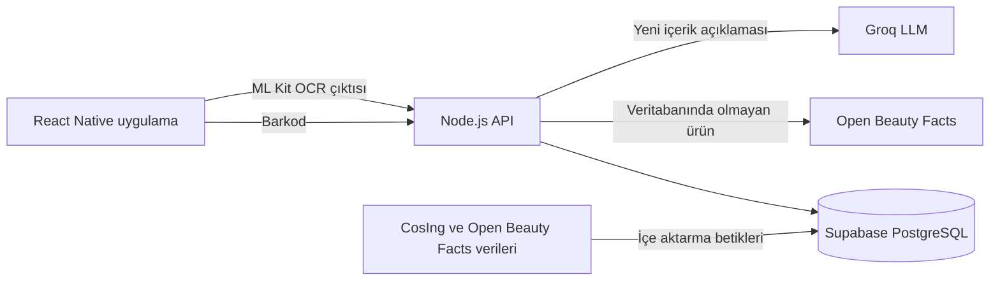

# GICERA

Kozmetik ürünlerini barkodla veya içerik listesinin fotoğrafıyla analiz eden bir cilt bakım mobil uygulaması. GICERA içerikleri AB'nin CosIng verileriyle karşılaştırır, ürüne temizlik skoru verir, hamilelikte dikkat edilmesi gereken maddeleri işaretler ve içerikleri sade Türkçeyle açıklar.

> **Durum:** Aktif olarak geliştiriliyor; yakın zamanda canlıya alınması planlanıyor.

## Özellikler

- **Barkodla ürün analizi:** Ürün önce kendi veritabanında, bulunamazsa Open Beauty Facts'te aranır.
- **Fotoğraftan içerik okuma:** Barkodu olmayan ürünlerde içerik listesi, yönlendirmeli çekilen en fazla 5 fotoğraftan cihaz üzerinde okunur.
- **Temizlik skoru:** İçerikler 0-100 arasında puanlanır; ürün temiz, orta veya riskli olarak derecelendirilir.
- **Güvenilirlik kontrolü:** Liste yeterince okunamadıysa uygulama tahminde bulunmak yerine skoru vermez.
- **Hamilelik modu:** Ürünlerde gebelik açısından işaretlenen içerikler gösterilir.
- **Cilde uygunluk:** Cilt profili testine göre ürünün hangi içeriklerinin uymayabileceği veya destek olabileceği belirtilir.
- **Yapay zeka ile içerik açıklaması:** Bir içeriğe dokunulduğunda Türkçe açıklaması gösterilir.
- **Günlük kullanım:** Tarama geçmişi, favoriler, ürün arama, sabah-akşam rutini ve konuma göre UV ile nem bilgisi.
- **Topluluk:** Kategorili forum, yanıtlar ve bildirimler.
- **Hesap yönetimi:** E-posta veya Google ile giriş, şifre sıfırlama ve hesaba bağlı cilt profili.

## Yapay Zeka ve Görüntü İşleme

### İçerik listesi tarama

Kavisli ambalajlar, yansımalar ve küçük yazılar içerik listesini tek fotoğraftan okumayı zorlaştırır. Bu nedenle tarama birkaç aşamadan geçer:

1. **OCR:** Her fotoğraf, Google ML Kit Text Recognition ile cihaz üzerinde okunur. Liste bulunduktan sonra ilgili bölge kırpılıp yüksek çözünürlükte yeniden okunur.
2. **Kalite kontrolü:** Bulanık veya yazısı çok küçük kalan fotoğraflar kullanılmaz ve yeniden çekim istenir.
3. **Birleştirme:** Fotoğraflar, ortak metin ve satır sırasına göre deterministik olarak birleştirilir. Çekim sırası sonucu değiştirmez ve hiçbir içerik adı tahminle tamamlanmaz.
4. **Yönlendirme:** Eksik kalan kısım bir sonraki fotoğrafta neyin çekilmesi gerektiğini belirler.
5. **Sunucu doğrulaması:** Satır sonlarında bölünen kelimeler ve okunan adlar CosIng sözlüğüyle kontrol edilir.
6. **Skor kararı:** Okuma kapsamı %85'in altındaysa veya tanınmayan bir ad riskli bir içeriğe benziyorsa skor gösterilmez.

### LLM ile içerik açıklaması

Açıklamalar önce veritabanında aranır. Kayıt yoksa [Groq](https://groq.com/) üzerinden LLM'den alınıp `madde_aciklamalari` tablosuna yazılır, böylece aynı içerik için model yeniden çağrılmaz. Aynı anda gelen aynı istekler tek çağrıda toplanır ve model bir adı tanımazsa (çoğunlukla OCR hatası) açıklama üretilmez.

### Skorlama

Skor LLM ile değil, açıklanabilir kurallarla hesaplanır. Her ürün 100 puanla başlar ve eşleşen içerikler için puan düşülür:

| İçerik türü | Ceza |
| --- | --- |
| Yasaklı (`banned`) | 60 |
| Kısıtlı (`restricted`) | 15 |
| Gebelikte sakıncalı (`pregnancy_unsafe`) | 10 |
| Tartışmalı (`controversial`) | 5 |

**Derece:** 80 ve üzeri temiz, 50-79 orta, 50'nin altı riskli.

## Mimari



## Teknolojiler

| Katman | Teknoloji |
| --- | --- |
| Mobil | React Native 0.86 (CLI), TypeScript, React Navigation |
| Kamera ve OCR | Vision Camera, Camera Kit, Google ML Kit Text Recognition |
| Backend | Node.js, Express, TypeScript, Zod |
| Veritabanı ve kimlik doğrulama | Supabase (PostgreSQL, Auth) |
| Yapay zeka | Groq API |
| Veri kaynakları | CosIng, Open Beauty Facts, Open-Meteo |
| Test | Jest (mobil), Node.js Test Runner (backend) |

Backend'de ayrıca Anthropic API ile fotoğraftan içerik okuyan isteğe bağlı `POST /api/analyze/image` ucu bulunur. Mobil uygulama bu ucu kullanmaz.

## Kurulum

**Gereksinimler:** Node.js 22.11+, JDK 17, Android Studio ve bir Supabase projesi. iOS için ayrıca macOS, Xcode ve CocoaPods gerekir.

### 1. Projeyi indirin

```bash
git clone https://github.com/cerenozmen/GICERA.git
cd GICERA
```

### 2. Veritabanını hazırlayın

`database/migrations/` içindeki dosyaları Supabase projenizde sırayla çalıştırın:

1. `0001_init.sql`
2. `0002_cosing.sql`
3. `0003_forum.sql`
4. `0004_madde_aciklamalari.sql`

### 3. Backend'i başlatın

```bash
cd backend
npm install
cp .env.example .env
```

`.env` dosyasını doldurun, verileri yükleyin ve sunucuyu başlatın:

```bash
npm run import:cosing
npm run import:obf
npm run dev
```

CosIng verisi yüklenmeden fotoğraftan içerik analizi çalışmaz. İçe aktarma betiklerinin ayrıntıları [backend/README.md](backend/README.md) dosyasındadır.

| Değişken | Zorunlu | Açıklama |
| --- | --- | --- |
| `SUPABASE_URL` | Evet | Supabase proje adresi |
| `SUPABASE_SERVICE_ROLE_KEY` | Evet | Backend'in veritabanı erişim anahtarı |
| `SUPABASE_ANON_KEY` | Önerilir | Giriş ve kayıt işlemleri için |
| `GROQ_API_KEY` | Hayır | Yeni içerik açıklamaları için |
| `ANTHROPIC_API_KEY` | Hayır | Yalnızca `POST /api/analyze/image` için |
| `OBF_API_BASE_URL` | Hayır | Open Beauty Facts API adresi |
| `PORT` | Hayır | Varsayılan: `4000` |

### 4. Mobil uygulamayı başlatın

Yeni bir terminalde:

```bash
cd frontend
npm install
npx react-native start
```

Başka bir terminalde:

```bash
adb reverse tcp:4000 tcp:4000
npx react-native run-android
```

Uygulama varsayılan olarak `localhost:4000` adresine bağlanır ve `adb reverse` bu bağlantıyı bilgisayardaki backend'e yönlendirir. Gerekirse adresi [frontend/src/config.ts](frontend/src/config.ts) içindeki `DEVICE_HOST` değeriyle değiştirebilirsiniz.

Kamera özellikleri için fiziksel cihazda test önerilir.

### Testler

```bash
cd backend && npm test
cd frontend && npm test
```

## API Özeti

Tüm uçlar `/api` altındadır. Sağlık kontrolü `GET /health` adresindedir.

| Metot | Adres | Açıklama |
| --- | --- | --- |
| `GET` | `/products/:barcode` | Barkoda göre ürün ve skor getirir |
| `GET` | `/products/search` | Ürün arar |
| `POST` | `/analyze/text` | İçerik listesi metnini analiz eder |
| `POST` | `/analyze/scan` | Yönlendirmeli taramayı doğrular ve analiz eder |
| `GET` | `/ingredients/explanation` | İçerik açıklamasını getirir |
| `POST` | `/ingredients/details` | İçerik ayrıntılarını getirir |
| `POST` | `/contributions` | Bulunamayan ürün için katkı gönderir |
| `GET`, `POST` | `/forum/posts` | Forum gönderilerini listeler veya oluşturur |
| `POST` | `/auth/signup`, `/auth/login`, `/auth/google` | Kayıt ve giriş işlemleri |

## Proje Yapısı

```text
GICERA/
├── frontend/                # React Native uygulaması
│   ├── src/
│   │   ├── screens/         # Uygulama ekranları
│   │   ├── guidedScan.ts    # Yönlendirmeli fotoğraf akışı
│   │   ├── ingredientScanner.ts  # OCR çıktısından liste çıkarma
│   │   ├── photoMerge.ts    # Fotoğrafları birleştirme
│   │   └── skinFit.ts       # Cilde uygunluk kuralları
│   └── __tests__/
├── backend/
│   └── src/
│       ├── routes/          # API uçları
│       ├── services/        # Skorlama, doğrulama ve LLM servisleri
│       ├── data/            # Kısıtlı içerik ve ad eşleştirme verileri
│       └── scripts/         # Veri aktarımı ve OCR ölçüm betikleri
└── database/
    ├── migrations/          # PostgreSQL şeması
    └── seeds/               # İsteğe bağlı demo forum verisi
```

## Yol Haritası

- [ ] Uygulamanın canlıya alınması
- [ ] Ödeme altyapısının bağlanması (abonelik ekranı hazır, satın alma henüz aktif değil)
- [ ] Kullanıcı katkıları için onay akışı

## Ekip

- **Ceren Özmen**
- **Gizem Korkmaz**

Geliştirme `ceren` ve `gizem` dallarında yürütülür, değişiklikler `main` dalına Pull Request ile alınır.

## Sorumluluk Reddi

GICERA'daki skorlar ve açıklamalar bilgilendirme amaçlıdır; tıbbi tavsiye yerine geçmez. Hamilelik veya cilt rahatsızlığı gibi durumlarda bir sağlık uzmanına danışın.
